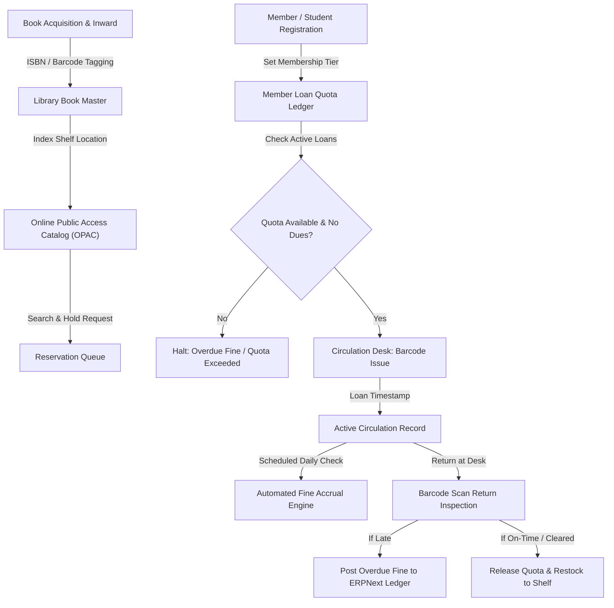

# 📚 Frappe Library Management — Automated Circulation & Cataloging Suite

[](https://frappeframework.com/)
[](https://erpnext.com/)
[]()
[]()
[](LICENSE)

A production-ready **Library Management & Digital Circulation System** built natively on the Frappe Framework for schools, colleges, universities, and public institutions.

---

## 🎯 The Real-World Client Problem & Library Pain Points

Institutions managing thousands of physical books, research journals, and multimedia assets face critical administrative hurdles:
1. **Unreturned Books & Asset Depreciation:** Inefficient tracking of loaned items leads to book loss, untracked inventory write-offs, and students graduating without returning critical reference material.
2. **Disputed Overdue Fine Calculations:** Manual calculation of per-day overdue penalties causes disputes during semester exam clearances and manual fee reconciliation errors.
3. **Slow Front-Desk Circulation Queues:** Manual check-out and check-in registers during peak library hours create long student queues and record transcription mistakes.
4. **Lack of Online Catalog (OPAC) Access:** Students and faculty members cannot remotely check real-time book availability, place reservations, or renew active book loans.

**How This Engine Solves It:** Features fast barcode-enabled circulation, automated daily overdue penalty ledgers, ISBN-based auto-cataloging, student quota enforcement, and a digital OPAC discovery portal.

---

## 🏛️ End-to-End Library Circulation & Architecture



---

## 🚀 Key Engineering Capabilities

- **ISBN Metadata & Dewey Decimal Classification:** Auto-fetches book metadata (title, author, publisher, edition) via OpenLibrary/Google Books APIs.
- **Fast Barcode Circulation Desk:** Single-click issue, return, and loan renewal workflows with instant audio/visual barcode scanner validation.
- **Automated Overdue Fine Calculation:** Background cron worker scans active loans at midnight, computes per-day statutory fines, and creates ERPNext billing charges upon return.
- **Tier-Based Quotas & Membership Caps:** Granular rules governing loan durations and max book limits for Undergraduate, Postgraduate, Faculty, and Research scholars.
- **Direct Clearance Integration:** Integrates with student campus ERP to block hall tickets or graduation certificates until all books and library dues are settled.

---

## 📂 Frappe DocType Schema & Data Structure

```text
library/
├── library_core/
│   ├── doctype/
│   │   ├── library_entry/           # Primary Transaction: Book Issue / Circulation Loan
│   │   │   ├── library_entry.json
│   │   │   ├── library_entry.py
│   │   │   └── library_entry.js
│   │   ├── library_item/            # Child Table: Borrowed Books, Accession Numbers & Condition
│   │   │   ├── library_item.json
│   │   │   └── library_item.py
│   │   ├── library_settings/        # Configuration: Loan Periods, Daily Fine Rates & Quota Rules
│   │   │   ├── library_settings.json
│   │   │   ├── library_settings.py
│   │   │   └── library_settings.js
│   │   └── library_audit_log/       # Audit: Tamper-proof Damaged/Lost Book Replacement Log
│   │       ├── library_audit_log.json
│   │       └── library_audit_log.py
│   ├── report/
│   │   └── library_summary/         # Overdue Books, Outstanding Fines & Circulation Velocity Report
│   │       ├── library_summary.json
│   │       ├── library_summary.py
│   │       └── library_summary.js
│   └── workspace/
│       └── library_workspace/       # Librarian Circulation Desk Dashboard
│           └── library_workspace.json
├── controllers/                     # Loan status transitions & fine computation
├── services/                        # ISBN API fetchers & student ID card scanners
├── tasks.py                         # Daily midnight overdue fines recalculation job
└── api.py                           # Whitelisted REST endpoints for student web portal
```

---

## 🛠️ Installation & Bench Setup

```bash
# 1. Fetch app into Frappe Bench
bench get-app https://github.com/shyampandey1104/frappe-library-management

# 2. Install on your academic site
bench --site campus.yourdomain.com install-app library

# 3. Run database migrations
bench --site campus.yourdomain.com migrate

# 4. Execute unit test suite
python3 -m unittest discover tests
```

---

## 📄 License
Released under the [MIT License](LICENSE). Built for educational institutions, corporate archives, and public library systems.
